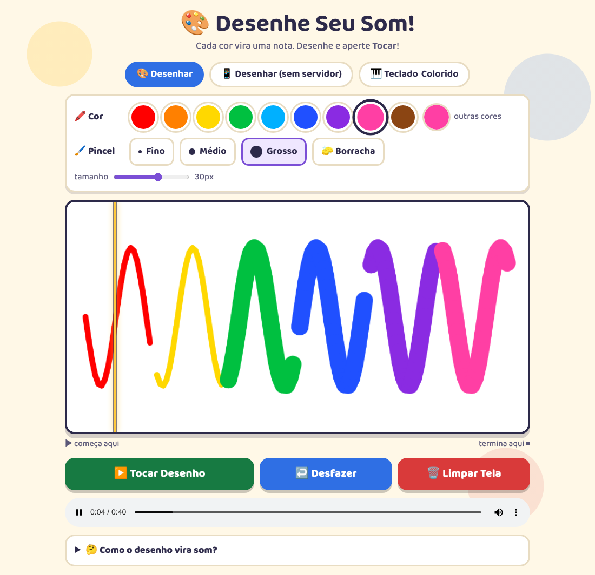
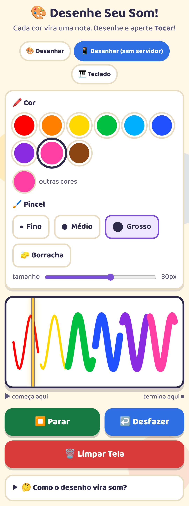
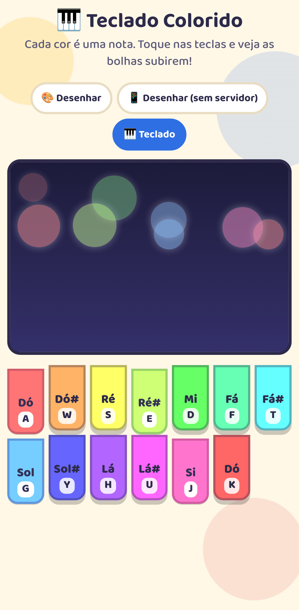
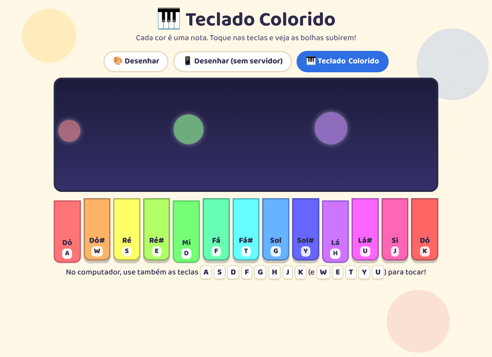

# Sinestinseut
Converte imagem em som. 🎨➡️🎵

Desenhe com cores e escute o seu desenho: o som lê o quadro da esquerda para a direita,
e cada cor vira uma nota. Feito para ser fácil de usar por crianças e adultos, no computador
ou no celular.

## Como rodar

- cd caminho/da/pasta
- pip install flask numpy scipy
- python app.py
- Abra http://127.0.0.1:5000/

## As três páginas

| Página | O que faz | Precisa do `app.py`? |
| --- | --- | --- |
| `index.html` | Desenhar e ouvir; o som é gerado em Python e dá para ouvir de novo no player | Sim |
| `gerador_mobile.html` | Mesmo app de desenho, com o som gerado direto no navegador | Não |
| `teclado_mobile.html` | Teclado colorido: cada tecla é uma cor e uma nota | Não |

As páginas que não precisam do servidor também funcionam abrindo o arquivo direto no
navegador, desde que `styles.css` e `desenho.js` estejam na mesma pasta.

  
  

## Como o desenho vira som

- ➡️ **Tempo**: o quadro é lido da esquerda para a direita (cada coluna de pixels dura 50 ms).
- 🌈 **Cor (matiz) = nota**: do vermelho (Dó) até o rosa/magenta (Si).
- 🎺 **Saturação = timbre**: cores clarinhas soam suaves (onda senoidal), cores fortes soam mais "zumbido" (onda quadrada).
- 🔊 **Brilho = volume**: cores claras tocam alto, escuras tocam baixinho; o preto fica em silêncio.

## Pensado para crianças

- Paleta com cores grandes, pincel fino/médio/grosso, borracha e botão **Desfazer** (também com Ctrl+Z).
- Funciona com o dedo no celular e no tablet.
- Uma linha amarela mostra qual parte do desenho está tocando.
- O teclado colorido tem teclas na tela (dá para tocar várias ao mesmo tempo) e mostra o nome das notas.
- Avisos amigáveis em vez de mensagens de erro.
